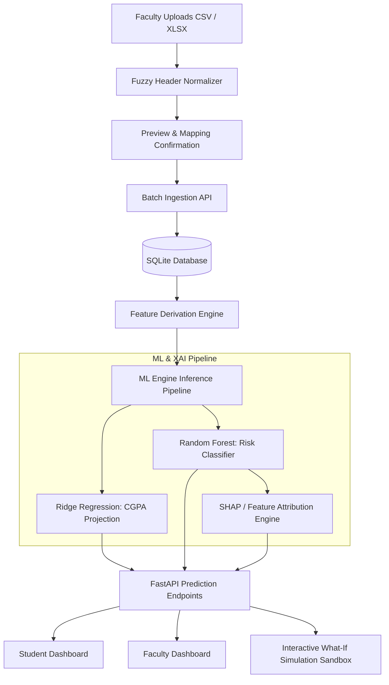

# Digital Class Twin: Complete Implementation Plan
## Machine Learning, Explainable AI, Dynamic File Ingestion & Simulation Sandbox

---

## 1. Executive Summary & Goals

This roadmap addresses the gap between the current rule-based / heuristic prototype and an end-to-end, production-grade AI system. Upon completion, the platform will feature:
1. **Machine Learning Core**:
   - **Ridge Regression**: For continuous academic metric forecasting (Projected CGPA / Exam score trajectories).
   - **Random Forest Classifier**: For multi-class student dropout / academic risk classification (`Low`, `Medium`, `High`).
2. **True Explainable AI (XAI)**:
   - Dynamic feature attribution (SHAP values & feature importance) displaying the exact positive and negative factors contributing to each student's risk profile.
3. **Dynamic / Schema-Agnostic File Ingestion Engine**:
   - Upload CSV, Excel (`.xlsx`, `.xls`), and TSV files with **arbitrary column names**.
   - Intelligent fuzzy column mapper (regex + semantic synonyms) automatically mapping uploaded headers to twin attributes (`reg_no`, `name`, `attendance`, `marks`, `semester`, etc.).
4. **Enhanced Real-Time What-If Simulation Sandbox**:
   - Live interaction with trained Ridge and Random Forest models to test hypothetical interventions (e.g. "+10% Attendance Recovery", "Remedial Coaching Score Shift") in-memory.
5. **Interactive UI & Evaluation Dashboards**:
   - Teacher Bulk Upload & Column Confirmation modal.
   - Student & Teacher XAI Waterfall charts.
   - Model Evaluation & Benchmark tab comparing Ridge Regression, Random Forest, and Heuristic baselines.

---

## 2. Gap Analysis & Checklist

| Area | Feature | Current State | Target State |
| :--- | :--- | :--- | :--- |
| **ML Engine** | **Ridge Regression** | ❌ Heuristic linear scaling in frontend | Trained `sklearn.linear_model.Ridge` model with serialization (`.joblib`), serving continuous CGPA predictions via REST API. |
| **ML Engine** | **Random Forest** | ❌ Hardcoded threshold if/else | Trained `sklearn.ensemble.RandomForestClassifier` predicting Risk Class + class probabilities. |
| **XAI** | **Feature Attribution** | 🟡 Static percentages (50/30/20) | True dynamic attribution via Random Forest feature importances / TreeSHAP values for each individual student. |
| **File Ingestion** | **Flexible File Upload** | ❌ Manual single-event entry | Multi-format upload (`.csv`, `.xlsx`, `.tsv`) with fuzzy header auto-detection, preview, and batch twin event dispatch. |
| **Simulation** | **What-If Sandbox** | 🟡 Client-side linear formula | Dual-mode simulator (Instant heuristic preview + live ML model inference). |
| **Alerts** | **Automated Warning Dispatch** | 🟡 In-app UI alert list only | Automated alert triggers on `Critical` twin state changes with multi-channel dispatch simulation. |

---

## 3. Architecture & Component Blueprint



---

## 4. Phased Implementation Roadmap

### Phase 1: Machine Learning & XAI Core (`ml-engine` & `backend`)
- [ ] **Dependencies Installation**:
  - Add `scikit-learn`, `joblib`, `pandas`, `openpyxl`, `shap`, `numpy` to `backend/requirements.txt`.
- [ ] **Synthetic Dataset Generation & Baseline Training Script**:
  - Create `backend/app/ml/train_models.py` generating realistic autonomous engineering college academic profiles (IAT 1, IAT 2, Semester Marks, Lab attendance, Quiz scores, Condonation risk).
  - Train **Ridge Regression** model (`models/ridge_cgpa_model.joblib`) with cross-validation.
  - Train **Random Forest Classifier** (`models/rf_risk_model.joblib`) with cross-validation, precision/recall/F1 metrics, and feature importance extraction.
- [ ] **Inference Service & XAI Explainer**:
  - Create `backend/app/ml/inference.py`:
    - Load persisted models into memory on FastAPI startup.
    - Provide `predict_risk(features)` returning risk category, confidence scores, and top driving risk factors.
    - Provide `predict_projected_cgpa(features)` predicting end-of-semester CGPA.
    - Provide `simulate_what_if(baseline_features, hypothetical_deltas)` for real-time sandbox exploration.
- [ ] **FastAPI Endpoints**:
  - `POST /api/ml/predict-risk`
  - `POST /api/ml/predict-cgpa`
  - `POST /api/ml/what-if-simulate`
  - `GET /api/ml/model-metrics` (Exposes accuracy, MAE, R², Confusion Matrix for review defense).

---

### Phase 2: Dynamic / Schema-Agnostic File Ingestion Engine
- [ ] **Intelligent Fuzzy Header Mapper**:
  - Create `backend/app/core/dynamic_importer.py` using `pandas` and fuzzy string matching:
    - Target fields: `student_id`, `reg_no`, `student_name`, `attendance_percentage`, `iat1_score`, `iat2_score`, `assignment_score`, `semester`.
    - Match any arbitrary header variants (e.g. `Register No`, `RegNo`, `Roll Number`, `Attnd %`, `Presence`, `IAT-I`, `Internal 1`, `Marks / 100`).
- [ ] **File Parsing Endpoint**:
  - `POST /api/upload/parse-preview`: Accepts `.csv`, `.xlsx`, `.tsv`.
    - Parses first 5–10 rows.
    - Returns identified column mappings with confidence scores and let users review/adjust before commit.
  - `POST /api/upload/commit-batch`:
    - Ingests verified rows into the SQLite database.
    - Automatically updates Digital Twin states and logs historical academic events.

---

### Phase 3: Frontend Integration (`client-app`)
- [ ] **Dynamic File Upload Page / Modal (Teacher Portal)**:
  - Create `client-app/src/pages/teacher/BulkUpload.jsx`:
    - Drag-and-drop file upload zone.
    - Visual column-mapping interface displaying detected vs. target fields.
    - Live data preview table before importing.
    - Progress bar & import summary toast.
- [ ] **Explainable AI (XAI) Factor Attribution Visualizer**:
  - Upgrade `client-app/src/pages/student/risk/RiskInsights.jsx` and `ClassOverview.jsx`:
    - Interactive horizontal bar chart / SHAP-style waterfall showing which factors increase or decrease risk.
    - Clear actionable advice tied to the dominant negative factors.
- [ ] **Connected What-If Simulator**:
  - Connect `client-app/src/pages/student/dashboard/Dashboard.jsx` sandbox slider directly to `/api/ml/what-if-simulate`.
  - Add toggles:
    - *Attendance Intervention* (+5% to +20%).
    - *Remedial Coaching Exam Boost* (IAT 2 improvement).
    - *Assignment Submission Recovery*.
- [ ] **Model Benchmark & Comparison Tab**:
  - Create `client-app/src/pages/teacher/ModelBenchmarks.jsx`:
    - Comparison charts between Ridge Regression, Random Forest, and Rule-based Baseline.
    - Displays MAE, RMSE, F1-Score, and ROC-AUC curve for project presentation.

---

## 5. File Structure of Additions

```
backend/
├── app/
│   ├── ml/
│   │   ├── __init__.py
│   │   ├── train_models.py         # Trains & serializes Ridge and Random Forest
│   │   ├── inference.py            # Serves predictions & SHAP explanations
│   │   ├── benchmark.py            # Generates comparative metrics
│   │   └── models/                 # Saved .joblib model binaries
│   ├── routers/
│   │   ├── ml_routes.py            # REST endpoints for ML predictions & XAI
│   │   └── upload_routes.py        # Flexible file upload & preview endpoints
│   └── core/
│       └── dynamic_importer.py     # Fuzzy header matcher & multi-format parser

client-app/
├── src/
│   ├── pages/
│   │   ├── teacher/
│   │   │   ├── BulkUpload.jsx      # Multi-format upload & mapping UI
│   │   │   ├── bulkUpload.css
│   │   │   ├── ModelBenchmarks.jsx # ML comparison and metrics UI
│   │   │   └── modelBenchmarks.css
│   │   └── student/
│   │       └── risk/
│   │           └── XaiWaterfall.jsx # Feature importance visualization
│   └── api/
│       └── mlApi.js                # API client for ML & upload services
```

---

## 6. Verification & Defense Checklist for Viva

- [ ] **Verification 1**: Upload a randomly formatted Excel/CSV file with non-standard headers (e.g. `Stud_Reg_No`, `Test1_Marks`) and verify automatic column detection.
- [ ] **Verification 2**: Run model verification script testing Ridge continuous predictions and Random Forest classifications against ground-truth data.
- [ ] **Verification 3**: Open Student Dashboard What-If slider and verify that hypothetical score adjustments trigger dynamic ML re-computation with real-time UI updates.
- [ ] **Verification 4**: Inspect the Explainable AI component to confirm dynamic feature contribution bars match the student's unique academic weaknesses.
