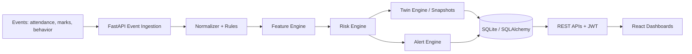

# Digital Class Twin — Review 2: Implementation

> Slide-ready content. Each `##` heading = one slide (or two).

---

## Slide 1 — Title
**Digital Class Twin**
AI-driven, event-driven platform for early dropout-risk prediction using a continuously updated student Digital Twin.
*Review 2 — Implementation Status*

---

## Slide 2 — Recap of the Problem & Objective
- Dropout risk is usually detected too late; data is scattered across attendance, marks and behavior.
- **Objective:** build a living virtual profile (Digital Twin) per student that
  - updates on every academic event,
  - predicts risk early with explainable factors,
  - lets counselors/teachers test "what-if" interventions.

---

## Slide 3 — System Architecture



| Module | Folder | Role |
|---|---|---|
| Backend | `backend/` | FastAPI APIs, auth, event pipeline, DB models |
| Frontend | `client-app/` | React + Vite role-based dashboards |
| ML Engine | `ml-engine/` | Feature extraction, risk & forecasting, twin updater |
| Contracts | `shared-contracts/` | Event / twin JSON schemas, API endpoint docs |

---

## Slide 4 — Technology Stack
- **Frontend:** React, Vite, Axios, React Router, custom CSS
- **Backend:** Python, FastAPI, Uvicorn, Pydantic
- **Database:** SQLAlchemy ORM (SQLite for dev), Alembic migrations
- **Security:** JWT authentication, password hashing, role-based access
- **ML:** Python (rule-based scoring now, `risk_engine.py`, `forecasting_engine.py`)
- **Tools:** Git/GitHub, Swagger (`/docs`), Postman

---

## Slide 5 — Backend Implementation
**Core pipeline (`backend/app/core/`)**
- `event_normalizer.py`, `event_rules.py`, `event_processor.py` — validate & process incoming typed events
- `feature_engine.py` — derives student features (attendance %, marks trend, behavior)
- `risk_engine.py` — composite risk score
- `twin_engine.py`, `twin_aggregation.py`, `twin_metrics.py`, `twin_trends.py` — twin state + trends
- `alert_engine.py` — triggers alerts on risk changes
- `session_tracker.py`, `security.py`, `token.py`, `ownership.py` — sessions, JWT, access ownership

**Database models:** User, Event, StudentFeatures, RiskScore, DigitalTwin, TwinSnapshot, Alert, InsightReview, ParentChildMap, TeacherClassMap, UserSession

---

## Slide 6 — REST API Modules (`backend/app/routers/`)
| Router | Purpose |
|---|---|
| `auth` | Login / token issue |
| `events` | Event ingestion |
| `twins` | Digital twin state & history |
| `insights` | Explainable risk insights |
| `alerts` | Risk alerts |
| `dashboard` | Aggregated dashboard data |
| `profile`, `linked_accounts` | User profile, parent–child links |
| `sessions`, `admin`, `system` | Session tracking, admin audit, health |

---

## Slide 7 — Digital Twin & Risk Logic

**Composite risk score**
```
score = 0.5 × Academic + 0.3 × Attendance + 0.2 × Behavior
score ≥ 75 → Low risk | 50–74 → Moderate | < 50 → High
```
**Twin state machine** (from `twin_engine.py`)
```
total_risk ≥ 75 → stable
total_risk ≥ 50 → warning
total_risk <  50 → critical
```
- A **TwinSnapshot** is stored only when state/risk changes → enables timeline and trend analysis.
- Explanation payload (academic, attendance, behavior, composite) returned for transparency.

---

## Slide 8 — ML Engine
- `feature_extractor.py` — builds features from events
- `risk_engine.py` — risk prediction (currently rule/threshold based)
- `forecasting_engine.py` — risk forecasting
- `twin_updater.py` — keeps twin in sync with new data
- Verified with `verify_digital_twin.py`
- **Next:** replace thresholds with trained model (`train_model.py`) and closed-loop calibration.

---

## Slide 9 — Frontend Implementation (`client-app/src/pages/`)
Role-based dashboards with protected routes:

| Role | Screens |
|---|---|
| **Student** | Dashboard, Digital Twin, Risk Insights, Alerts, Submit Event, Rewards, Profile |
| **Teacher** | Dashboard, Class Overview, Risk Hub, Profile |
| **Parent** | Dashboard, Child Twin, Academic Reports |
| **Admin** | Dashboard, Audit Log, System Health |

- `Login.jsx` + `auth/` — JWT login and role-based redirect
- `api/axios.js`, `student.api.js` — API layer with token interceptor
- `simulations/` — simulated student/teacher/parent profiles, engineering semester data and LLM-style insight engine for demo

---

## Slide 10 — Key Features Implemented
1. Event-driven twin updates (typed events)
2. JWT login with role-based access (student / teacher / parent / admin)
3. Explainable risk scores & insights
4. Twin snapshots and trend history
5. Automated alerts on risk change
6. Parent–child and teacher–class mapping with ownership checks
7. Gamified student rewards
8. Admin audit log and system health monitor
9. Demo data seeding (`seed_demo.py`) and simulation mode

---

## Slide 11 — Data Flow Walkthrough (Demo)
1. Student/teacher submits an event (e.g., absence, low marks).
2. Backend normalizes and validates it, stores it.
3. Features are recomputed → risk score updated.
4. Twin state changes (stable → warning) → snapshot saved.
5. Alert generated → shown on student, teacher and parent dashboards.
6. Dashboard displays updated twin, trend and explanation.

---

## Slide 12 — Setup / How to Run
```bash
# Backend
cd backend && pip install -r requirements.txt
uvicorn app.main:app --reload      # http://127.0.0.1:8000/docs

# Frontend
cd client-app && npm install && npm run dev   # http://localhost:5173

# Twin logic check
python verify_digital_twin.py
```

---

## Slide 13 — Testing & Validation
- API testing via Swagger UI / Postman
- `verify_digital_twin.py` validates twin pipeline end-to-end
- Seeded demo data for multiple roles
- Schema consistency through `shared-contracts/` (`eventSchema.json`, `twinSchema.json`, `apiEndpoints.md`)

---

## Slide 14 — Challenges & Solutions
| Challenge | Solution |
|---|---|
| Multiple roles with different data views | Ownership checks + role-based routes |
| Keeping twin in sync with events | Event-driven pipeline + snapshots |
| Explaining predictions | Per-factor breakdown with composite score |
| Frontend/backend mismatch | Shared contracts and schemas |

---

## Slide 15 — Remaining Work & Roadmap
- Replace rule-based risk with trained ML model
- Typed events (medical vs. unexcused absence, behavior flags)
- "Initializing" / "Stale" twin states
- **What-If simulator** (shadow twin for interventions)
- Closed-loop calibration against real outcomes
- Production DB (PostgreSQL) and deployment

---

## Slide 16 — Conclusion
A working end-to-end prototype: events → features → risk → Digital Twin → alerts → role-based dashboards. Next phase focuses on real ML models and the what-if intervention simulator.

**Thank you — Questions?**
