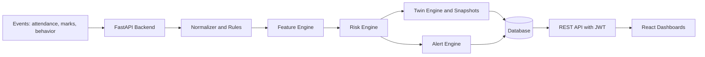

# Digital Class Twin — Review 2 PPT (Slide-wise Content)

> Items marked **[FILL]** need your own details. Verify the literature table and references before submitting.

---

## Slide 1 — Title & Team Members

**Digital Class Twin: An AI-Driven, Event-Based Digital Twin for Early Student Dropout Risk Prediction**

| Team Member | Register No. | Role |
|---|---|---|
| Altrin | [FILL] | [FILL] |
| Jins | [FILL] | [FILL] |
| Jerish | [FILL] | [FILL] |
| Mukhilan | [FILL] | [FILL] |
| Rethna | [FILL] | [FILL] |

- **Guide / Supervisor:** [FILL]
- **Department & College:** [FILL]
- **Review 2 — Mini Project** | Academic Year [FILL]

---

## Slide 2 — Abstract & Problem Statement

**Abstract**
- Digital Class Twin builds a continuously updated virtual academic profile (Digital Twin) for every student.
- Attendance, marks and behavior are captured as events and turned into features and a risk score.
- The system predicts dropout risk early, explains the reasons, and alerts teachers, parents and students.
- Role-based dashboards for Student, Teacher, Parent and Admin.

**Problem Statement**
- Dropout and academic failure are usually noticed too late, after attendance shortage or exam failure.
- Student data is scattered across attendance, internals and behavior records.
- Existing systems are reactive and give no explanation of *why* a student is at risk.
- Teachers and parents have no tool to see trends or test interventions.

**Objectives**
1. Create a live Digital Twin per student.
2. Predict risk early with an explainable score.
3. Send automatic alerts to teachers and parents.
4. Provide role-based dashboards.

---

## Slide 3 — Literature Survey & Research Gap

| # | Work | Approach | Limitation |
|---|---|---|---|
| 1 | Romero & Ventura (2010) | Educational Data Mining review | Mostly offline analysis, no live updates |
| 2 | Arnold & Pistilli (2012), Course Signals | Early-warning on LMS data | Limited to LMS activity; little explanation |
| 3 | Baker & Siemens (2014) | Learning analytics frameworks | Not tied to a continuously updated student model |
| 4 | Lundberg & Lee (2017), SHAP | Explainable predictions | General method, not an education platform |
| 5 | Grieves & Vickers (2017) | Digital Twin concept | Mainly industrial, not education |

**Research Gap**
- Few systems combine a **live, event-driven Digital Twin** with **explainable risk scoring** in education.
- Most tools are batch and reactive.
- Little support for parents and **what-if intervention testing**.

**Our contribution:** event-driven twin + explainable risk + alerts + multi-role dashboards.

---

## Slide 4 — Proposed System Design



**Modules**
- **Backend (FastAPI):** event ingestion, auth, APIs
- **Feature & Risk engines:** compute metrics and score
- **Twin engine:** twin state + history snapshots
- **Alert engine:** triggers notifications
- **Frontend (React + Vite):** Student, Teacher, Parent, Admin views
- **ML engine:** feature extraction, forecasting

---

## Slide 5 — Design Methodology

- **Development model:** iterative / incremental (module by module, reviewed each cycle).
- **Architecture:** client–server, layered (routers → core logic → models → database).
- **Event-driven design:** every new event triggers feature update → risk update → twin update.
- **Contract-first:** shared JSON schemas (`eventSchema.json`, `twinSchema.json`) and API docs keep frontend and backend consistent.
- **Security:** JWT authentication, role-based access, ownership checks (parent ↔ child, teacher ↔ class).
- **Explainability by design:** each score returns its academic, attendance and behavior components.
- **Tools:** Python, FastAPI, SQLAlchemy, Alembic, React, Vite, Git/GitHub, Swagger.

---

## Slide 6 — Implementation Algorithm, Model & Design

**Algorithm (per event)**
```
1. Receive event (attendance / marks / behavior)
2. Validate and normalize it, then store it
3. Recompute student features
4. Compute risk:
     score = 0.5*Academic + 0.3*Attendance + 0.2*Behavior
5. Classify:
     score >= 75 -> Low risk, twin = stable
     50 <= score < 75 -> Moderate, twin = warning
     score < 50 -> High, twin = critical
6. If state/risk changed -> save TwinSnapshot
7. If risk worsened -> generate alert
8. Return updated twin + explanation to dashboards
```

**Model**
- Weighted, explainable scoring model (current version).
- Planned: trained ML classifier plus forecasting, with calibration.

**Database design:** User, Event, StudentFeatures, RiskScore, DigitalTwin, TwinSnapshot, Alert, ParentChildMap, TeacherClassMap, UserSession.

---

## Slide 7 — Implementation Progress

| Module | Status |
|---|---|
| Backend APIs (auth, events, twins, insights, alerts, dashboard, admin) | Done |
| JWT login & role-based access | Done |
| Event pipeline: normalize, features, risk | Done |
| Twin engine with snapshots and trends | Done |
| Alert engine | Done |
| Student, Teacher, Parent, Admin dashboards | Done |
| Demo / simulation mode with sample students | Done |
| ML engine (feature extraction, risk, forecasting) | Rule-based; ML in progress |
| What-if simulator | Planned |
| Closed-loop calibration | Planned |

**Screenshots to add [FILL]:** Login, Student Dashboard, Digital Twin, Risk Insights, Teacher Risk Hub, Parent view, Swagger `/docs`.

**Demo flow:** submit event → risk updates → twin state changes → alert shown.

---

## Slide 8 — Conclusion

- Built a working prototype: events → features → risk → Digital Twin → alerts → role-based dashboards.
- Provides early, explainable risk detection instead of reactive reporting.
- Teachers, parents and students get a shared, live view of academic status.

**Future work**
- Train and validate a real ML model on real data
- What-if intervention simulator
- Typed events and "Initializing / Stale" twin states
- Closed-loop calibration
- Production database and deployment

---

## Slide 9 — References

1. C. Romero and S. Ventura, "Educational Data Mining: A Review of the State of the Art," *IEEE Trans. Systems, Man, and Cybernetics, Part C*, vol. 40, no. 6, pp. 601–618, 2010.
2. K. E. Arnold and M. D. Pistilli, "Course Signals at Purdue: Using Learning Analytics to Increase Student Success," *Proc. 2nd Int. Conf. Learning Analytics and Knowledge (LAK)*, 2012.
3. R. S. Baker and G. Siemens, "Educational Data Mining and Learning Analytics," in *Cambridge Handbook of the Learning Sciences*, 2nd ed., 2014.
4. S. M. Lundberg and S.-I. Lee, "A Unified Approach to Interpreting Model Predictions," *Advances in Neural Information Processing Systems (NeurIPS)*, 2017.
5. M. Grieves and J. Vickers, "Digital Twin: Mitigating Unpredictable, Undesirable Emergent Behavior in Complex Systems," in *Transdisciplinary Perspectives on Complex Systems*, Springer, 2017.
6. FastAPI Documentation — https://fastapi.tiangolo.com
7. React Documentation — https://react.dev
8. SQLAlchemy Documentation — https://docs.sqlalchemy.org
