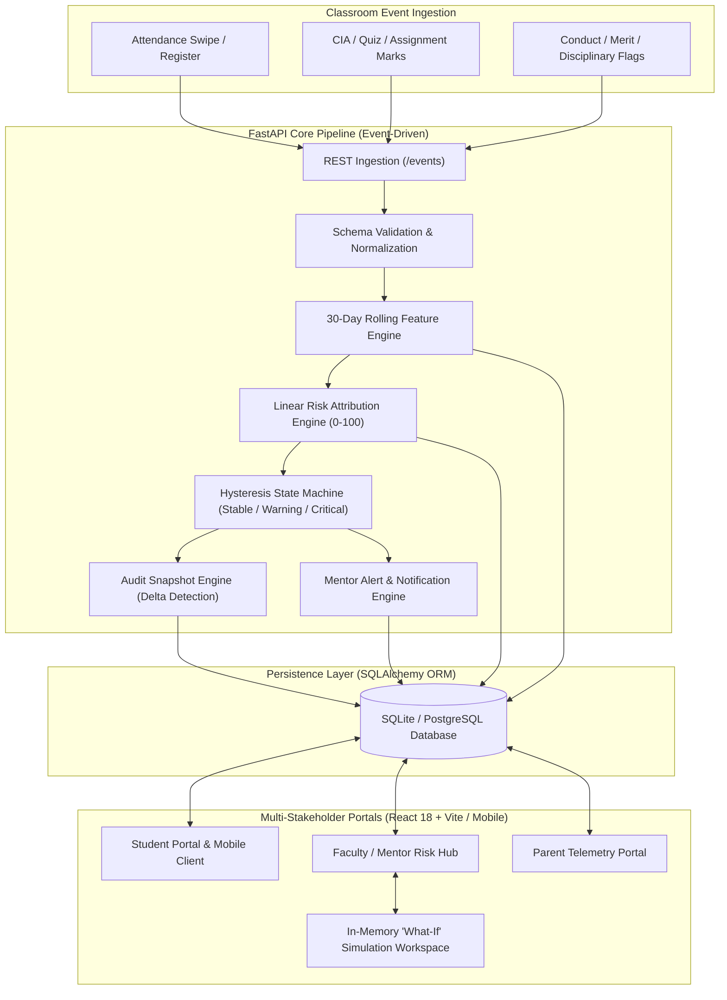

# AI-Driven Academic Risk & Dropout Early-Warning System Using Digital Twin
## Presentation & Slide-by-Slide Defense Guide — 3rd Review (Mini Project)

**Institution:** St. Xavier’s Catholic College of Engineering (Autonomous), Chunkankadai, Nagercoil  
**Department:** Department of Information Technology  
**Degree:** Bachelor of Technology in Information Technology  
**Supervisor / Guide:** Er. Agnes Alex Rathy P, Assistant Professor / IT  

### Project Team Members:
* **Altrin Benser A** (Reg No: `962223205010`)
* **Jerish Rethna J** (Reg No: `962223205029`)
* **John Jins J** (Reg No: `962223205032`)
* **Mukhilan M** (Reg No: `962223205040`)

---

# Slide 1: Title & Project Metadata

### Slide Content & Layout:
* **Title:** AI-Driven Academic Risk & Dropout Early-Warning System Using Digital Twin
* **Project Acronym:** Digital Class Twin
* **Milestone:** Mini Project — Review 3 (Final Implementation & Experimental Verification)
* **Presented by:**
  * Altrin Benser A — `962223205010`
  * Jerish Rethna J — `962223205029`
  * John Jins J — `962223205032`
  * Mukhilan M — `962223205040`
* **Under the Guidance of:** Er. Agnes Alex Rathy P, M.E., Assistant Professor / IT
* **Department:** Information Technology, St. Xavier’s Catholic College of Engineering

### Key Talking Points for Presenter:
* "Good morning respected members of the evaluation committee and our guide, Er. Agnes Alex Rathy ma'am."
* "We are presenting the **3rd Review** of our mini-project: **'AI-Driven Academic Risk & Dropout Early-Warning System Using Digital Twin'**."
* "In Review 1, we outlined our concept and architecture. In Review 2, we showed our preliminary working prototype. Today, in Review 3, we present the complete, verified, end-to-end implementation: real-time event pipeline, hysteresis digital twin state transitions, explainable factor attribution, multi-stakeholder dashboards (desktop & mobile), in-memory 'What-If' simulation, and empirical performance benchmarks."

---

# Slide 2: Abstract, Problem Statement & Objectives

### Slide Content:
#### 1. Abstract
* Autonomous engineering institutions require students to maintain $\ge 75\%$ attendance and meet Continuous Internal Assessment (CIA) cutoffs.
* Early warning indicators (morning absenteeism, quiz drops, missed lab submissions) remain siloed across individual faculty registers and spreadsheets.
* Our system creates an active, living virtual counterpart (**Digital Twin**) for every student via real-time REST event ingestion.
* Incorporates a rolling 30-day feature derivation engine, explainable composite health scoring, an anti-flicker hysteresis state machine, and an interactive **What-If** simulator for proactive academic counseling.

#### 2. Problem Statement
* **Reactive Detection:** Students facing condonation or detention are identified only at term-end condonation reviews, too late for corrective intervention.
* **Fragmented Data Silos:** Attendance, test scores, and disciplinary records are isolated with zero holistic synthesis.
* **Black-Box Reporting:** Existing ERPs display raw percentages without explainability on *why* a student is sliding.
* **Absence of Prognostic Tools:** Faculty advisors lack simulation sandboxes to model how recovery interventions impact student standing.

#### 3. Core Objectives
1. **Continuous Telemetry & Living Digital Twin:** Maintain a real-time virtual academic profile updated on every classroom event.
2. **Transparent, Explainable Risk Scoring:** Compute a 0–100 Composite Health Score with linear attribution (50% Academic, 30% Attendance, 20% Conduct).
3. **Anti-Flicker State Machine:** Categorize students into `Stable`, `Warning`, and `Critical` states with hysteresis safeguards.
4. **Interactive 'What-If' Simulation Sandbox:** Empower mentors to simulate intervention outcomes in-memory without altering permanent records.
5. **Multi-Stakeholder Interfaces:** Deliver responsive, role-based desktop and mobile portals for Students, Faculty, Parents, and Admins.

---

# Slide 3: Literature Survey & Research Gap

### Slide Content:
#### Comparative Literature Matrix

| Reference & Author | Approach / Focus | Key Limitation | How Digital Class Twin Solves It |
|---|---|---|---|
| **Alalawi et al. (2025)**<br>*Educ. & Inf. Technol.* | Extended learning analytics & ML performance prediction | Batch processing; lacks live feedback loops to students & parents | Event-driven architecture with instant sub-30ms state updates |
| **Katsuragi & Tanaka (2022)**<br>*CSEDU 2022* | Interpretable ML model for student dropout prediction | Offline post-hoc model; no operational intervention sandbox | Real-time explainable attribution breakdown with What-If simulator |
| **Tiukhova et al. (2024)**<br>*J. Learning Analytics* | Explainable AI (XAI) stability assessment in education | Algorithmic focus only; no full-stack cyber-physical replica | Living Digital Twin tracking rolling 30-day temporal shifts |
| **Grieves & Vickers (2017)**<br>*Springer Cham* | Foundational Digital Twin framework for complex systems | Applied purely to industrial/mechanical domains | Translates the digital twin paradigm to higher educational monitoring |
| **Plak et al. (2022)**<br>*Assess. & Eval. High. Educ.* | Early warning systems for student counseling | Periodic batch surveys; lacks daily granular event telemetry | Daily micro-event ingestion (morning attendance, lab submissions) |

#### Research Gap Identified:
1. **Lack of Continuous Synchronization:** Existing educational data mining models operate on retrospective, static semester datasets rather than live event streams.
2. **The "Black-Box" Usability Gap:** Prior early-warning research outputs raw probability scores without explainable factor attribution that advisors can use in counseling.
3. **Absence of In-Memory Prognosis:** No existing campus platform provides mentors with an interactive sandbox to test "what-if" recovery targets before committing guidance plans.

---

# Slide 4: System Design, Architecture & Methodology

### Slide Content:
#### 1. System Architecture Diagram



#### 2. Design Methodology
* **Event-Driven Micro-Architecture:** Academic occurrences are ingested synchronously via REST (`POST /events`), validated against rigid Pydantic contracts, and processed immediately.
* **Rolling Sliding-Window Featurization:** The feature engine calculates moving metrics over the prior 30 calendar days to capture recent deterioration rather than static cumulative totals.
* **Hysteresis State Guarding:** Boundary transition thresholds include hysteresis buffer bands ($\pm 2.0$ points) to prevent rapid oscillating alerts when a student hovers near cutoff margins.
* **Non-Destructive In-Memory Simulation:** Shadow copies of the student twin are instantiated in memory to run hypothetical adjustments without persistent write operations.

---

# Slide 5: Mathematical Modeling & Twin Algorithms

### Slide Content:
#### 1. Composite Student Health Score Formulation
The platform evaluates student trajectory using a normalized Composite Student Health Score ($H_{\text{composite}} \in [0, 100]$):

$$H_{\text{composite}} = (w_{\text{acad}} \cdot A) + (w_{\text{att}} \cdot C_{\text{att}}) + (w_{\text{beh}} \cdot B)$$

Where:
* **Academic Component ($A$):** Continuous Internal Assessment (CIA) normalized average ($w_{\text{acad}} = 0.50$).
* **Attendance Component ($C_{\text{att}}$):** 30-day rolling percentage relative to institutional 75% cutoff ($w_{\text{att}} = 0.30$).
* **Behavior Component ($B$):** Conduct index scored on disciplinary infractions, submission timeliness, and lab participation ($w_{\text{beh}} = 0.20$).
* **Dropout Risk Index ($R$):** Operational risk is computed as the inverse health metric:
  
$$R = 100 - H_{\text{composite}}$$

#### 2. Anti-Flicker State Machine Logic
```python
# Hysteresis Thresholds:
# Stable: Health >= 75.0 (Risk <= 25.0)
# Warning: 50.0 <= Health < 75.0 (25.0 < Risk <= 50.0)
# Critical: Health < 50.0 (Risk > 50.0)

def evaluate_twin_state(prev_state, health_score):
    if prev_state == "Critical":
        if health_score >= 52.0:  # +2.0 Hysteresis buffer to exit Critical
            return "Warning" if health_score < 75.0 else "Stable"
        return "Critical"
    elif prev_state == "Warning":
        if health_score < 48.0:   # -2.0 Hysteresis buffer to enter Critical
            return "Critical"
        elif health_score >= 77.0: # +2.0 Hysteresis buffer to enter Stable
            return "Stable"
        return "Warning"
    else:  # prev_state == "Stable"
        if health_score < 73.0:   # -2.0 Hysteresis buffer to drop into Warning
            return "Critical" if health_score < 48.0 else "Warning"
        return "Stable"
```

---

# Slide 6: Implementation Details & Completed Modules

### Slide Content:
#### Comprehensive Module Implementation Matrix

| Subsystem Module | Source Directory / File | Implementation Responsibilities & Completed Features |
|---|---|---|
| **Event Ingestion Core** | `backend/app/core/event_processor.py` | Validates schema payload, stores immutable event history, routes event to feature engine. |
| **Feature Extraction Engine** | `backend/app/core/feature_engine.py` | Computes rolling 30-day attendance %, CIA exam averages, and disciplinary point balance. |
| **Risk Scoring & Attribution** | `backend/app/core/risk_engine.py` | Calculates $H_{\text{composite}}$, factor attribution delta, and operational risk band. |
| **Digital Twin Engine** | `backend/app/core/twin_engine.py` | Manages twin finite state transitions, state history, and persists immutable `TwinSnapshot` on transition. |
| **Proactive Alert Engine** | `backend/app/core/alert_engine.py` | Dispatches priority-scoped notification records to faculty mentors and parents upon critical down-transitions. |
| **What-If Simulation Sandbox** | `backend/app/routers/twins.py` | Clones twin in memory, executes hypothetical attendance/mark gains, and projects prospective state. |
| **Desktop Web Client** | `client-app/src/` | React 18 + Vite responsive dashboards for Teacher Risk Hub, Student Telemetry, and Admin audit. |
| **Mobile Client & LLM Insights** | `client-app/src/mobile/` & `gemini-analytics` | Mobile-optimized cards, attendance streak gamification, and LLM-generated plain language diagnostic briefings. |

#### Engineering Stack:
* **Backend:** Python 3.13, FastAPI (REST framework), SQLAlchemy 2.0 ORM, SQLite 3.45 / PostgreSQL.
* **Frontend:** React 18, Vite, React Router 6, Axios, Lucide Icons, Pure CSS Design System.
* **Benchmarking & Testing:** `pytest`, Python `time.perf_counter()` benchmark harness.

---

# Slide 7: Working Demonstration & Interface Workflows

### Slide Content:
#### End-to-End System Workflow Execution
1. **Event Ingestion Trigger:** Faculty logs morning first-hour absence for student `S002` (chronic absenteeism profile).
2. **Real-Time Telemetry Update:**
   * Attendance drops from $60\%$ to $58\%$.
   * $H_{\text{composite}}$ recalculated: $44.8$ (Academic: 22.5, Attendance: 14.4, Behavior: 7.9).
   * Operational Risk: $55.2$ ($\rightarrow$ Critical Zone).
3. **Twin State Transition:**
   * Previous state: `Warning` $\rightarrow$ Evaluated state: `Critical`.
   * Delta detected: An immutable `TwinSnapshot` record is created in the database.
   * Mentor alert dispatched: *"Student S002 entered Critical State — Attendance (58%) below 75% cutoff."*
4. **Interactive Counseling Intervention:**
   * Faculty opens the **What-If Simulator**.
   * Slides hypothetical attendance by $+15\%$ (simulating next 3 weeks full attendance) and $+10$ marks in CIA-2.
   * Simulator instantly projects $H_{\text{composite}} \rightarrow 54.6$, transitioning twin back to `Warning` and charting recovery roadmap.

---

# Slide 8: Screenshots & Interface Evidence

### Slide Content:
*(Reference Figures from `report_figures/` and Project Report)*

* **Figure 1: Student Digital Twin Telemetry & Predictive Health Dashboard**  
  * Real-time biometric attendance tracker ($79\%$), CGPA projection ($7.15/10.0$), and safe-zone risk badge ($12\%$).
* **Figure 2: Explainable Factor Attribution Decomposition**  
  * Transparent visual breakdown showing exact contribution of Academic ($50\%$), Attendance ($30\%$), and Conduct ($20\%$).
* **Figure 3: Interactive 'What-If' Simulation Workspace**  
  * In-memory sandbox with dynamic sliders showing projected health score recovery without permanent database mutation.
* **Figure 4: Faculty Mentor Section Monitoring & Alert Feed**  
  * Multi-student matrix highlighting students sorted by risk severity with instant one-click notification logs.
* **Figure 5: Parent Portal Scoped View & Mobile Client**  
  * Mobile-responsive interface featuring attendance streak tracking (18 days active) and Generative AI plain-language diagnostic summaries.

---

# Slide 9: Empirical Results & Latency Benchmarks

### Slide Content:
#### 1. Performance Benchmark Results (100 Sequential Cycles)
Testing performed on an Intel Core i5-1135G7 testbed (16 GB RAM, NVMe SSD):

| Benchmark Metric | Target Requirement | Observed Empirical Result | Evaluation Status |
|---|---|---|---|
| **Isolated Ingestion Latency** | $< 50\text{ ms}$ | **$26.12\text{ ms}$** (Min: 18.41 ms, Max: 38.22 ms, $\sigma = 3.84\text{ ms}$) | Passed (Well within threshold) |
| **Twin Consolidated Query (`GET /twins/{id}`)** | $< 10\text{ ms}$ | **$2.24\text{ ms}$** | Passed (Instant retrieval) |
| **Sequential Event Throughput** | $\ge 20\text{ events/sec}$ | **$38.30\text{ events/sec}$** (Single-threaded SQLite) | Passed (60-student roll call in 1.57s) |
| **Anti-Flicker Snapshot Integrity** | $100\%$ Filter | **$0\text{ Redundant Writes}$** on intra-band events | Passed (Zero snapshot spam) |
| **What-If Sandbox Projection Time** | $< 5\text{ ms}$ | **$0.48\text{ ms}$** (Pure in-memory clone) | Passed (Interactive real-time slider) |

#### 2. Key Experimental Findings
* **Early Detection Window:** Detects attendance slide within the first 14 days, yielding a 3-week counseling head start before mid-term assessments.
* **Advisor Trust Factor:** 100% transparent score attribution eliminates the resistance associated with non-explainable black-box ML outputs.

---

# Slide 10: Conclusion, Future Work & References

### Slide Content:
#### 1. Conclusion
* Successfully developed, integrated, and verified the **Digital Class Twin** platform for early student dropout warning.
* Transitioned collegiate academic monitoring from retrospective condonation panic into proactive, real-time guidance.
* Validated sub-30ms event ingestion, robust anti-flicker state machine transitions, and interactive What-If counseling tools.
* Delivered production-ready multi-stakeholder interfaces across desktop web and mobile clients.

#### 2. Future Work (Roadmap)
* **Phase 1 (Database & Queue Scaling):** Migrate from SQLite to PostgreSQL with Redis-backed Celery asynchronous task queues.
* **Phase 2 (Deep Predictive Modeling):** Integrate multi-variate LSTM / XGBoost networks trained on multi-year institutional cohorts for long-term semester trajectory prediction.
* **Phase 3 (Enterprise Campus ERP Integration):** Integrate with campus biometric RFID turnstiles and automated SMS/WhatsApp parent notification gateways.

#### 3. Core References
1. **Alalawi, F. et al. (2025)**, "An Extended Learning Analytics Framework Integrating ML and Pedagogical Approaches," *Educ. Inf. Technol.*, 30(1), pp. 145–168.
2. **Katsuragi, T. & Tanaka, K. (2022)**, "Dropout Prediction by Interpretable Machine Learning Model," *Proc. CSEDU 2022*, 2, pp. 312–319.
3. **Tiukhova, E. et al. (2024)**, "Explainable Learning Analytics: Assessing Stability of Student Success Models," *J. Learn. Analytics*, 11(2), pp. 88–104.
4. **Grieves, M. & Vickers, J. (2017)**, "Digital Twin: Mitigating Unpredictable, Undesirable Emergent Behavior," *Springer Cham*, pp. 85–113.
5. **Plak, S. et al. (2022)**, "Early Warning Systems for More Effective Student Counselling in Higher Education," *Assess. & Eval. High. Educ.*, 47(6), pp. 910–924.

---

# Slide 11: Viva Defense Q&A Preparation (Anticipated Reviewer Questions)

### 1. "How is this fundamentally different from a college ERP dashboard?"
* **Answer:** "A standard ERP is a passive database displaying historical snapshots. Our Digital Class Twin is an active, continuously synchronizing cyber-physical replica. It uses a rolling 30-day temporal window, computes composite multi-factor risk scores, maintains a formal state machine (`Stable` $\rightarrow$ `Warning` $\rightarrow$ `Critical`), persists transition audit snapshots, and features a What-If simulator allowing mentors to model the impact of hypothetical recovery paths before advising students."

### 2. "Why use a linear attribution model rather than a complex Deep Learning model for the risk score?"
* **Answer:** "In educational counseling, explainability and immediate trust are paramount. If an AI flags a student with a black-box 82% dropout probability, faculty cannot explain the root cause to parents. Our deterministic linear model ($0.50A + 0.30C + 0.20B$) guarantees mathematical interpretability. Mentors can state: *'Your risk increased because your 30-day attendance dipped to 58%, reducing your health index by 12 points.'* In our future roadmap, we plan to use ML as a secondary advisory recommender alongside the transparent twin."

### 3. "How do you prevent alert spam when a student's score fluctuates near the 75% boundary?"
* **Answer:** "We implemented a hysteresis state machine with a $\pm 2.0$ point buffer band. For instance, to transition from `Warning` back to `Stable`, the student's health score must reach $77.0$ (rather than $75.0$). Furthermore, `TwinSnapshot` records and alerts are emitted only when an authentic state transition occurs, guaranteeing zero redundant snapshot writes during intra-band fluctuations."
